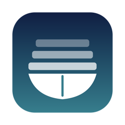
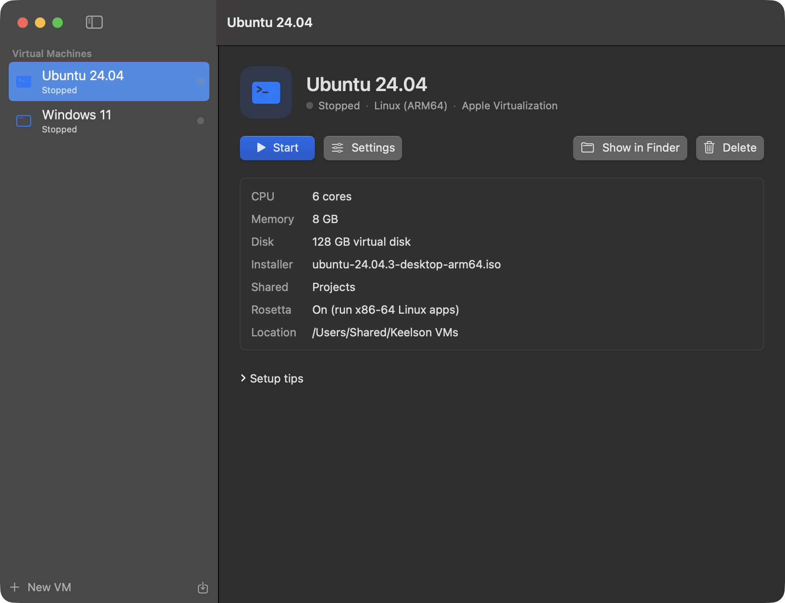
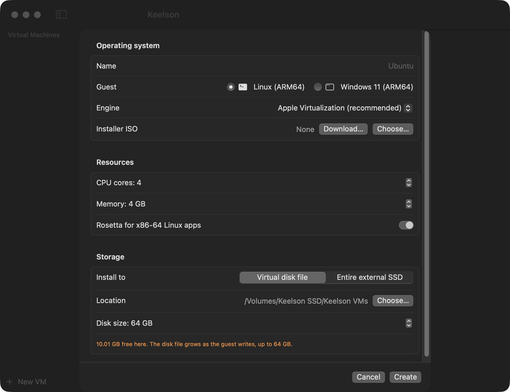
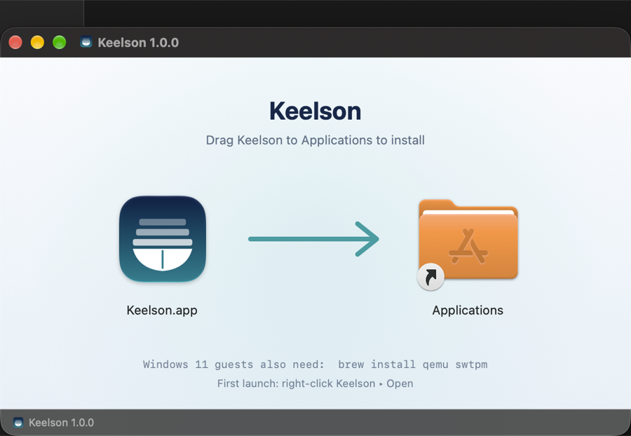
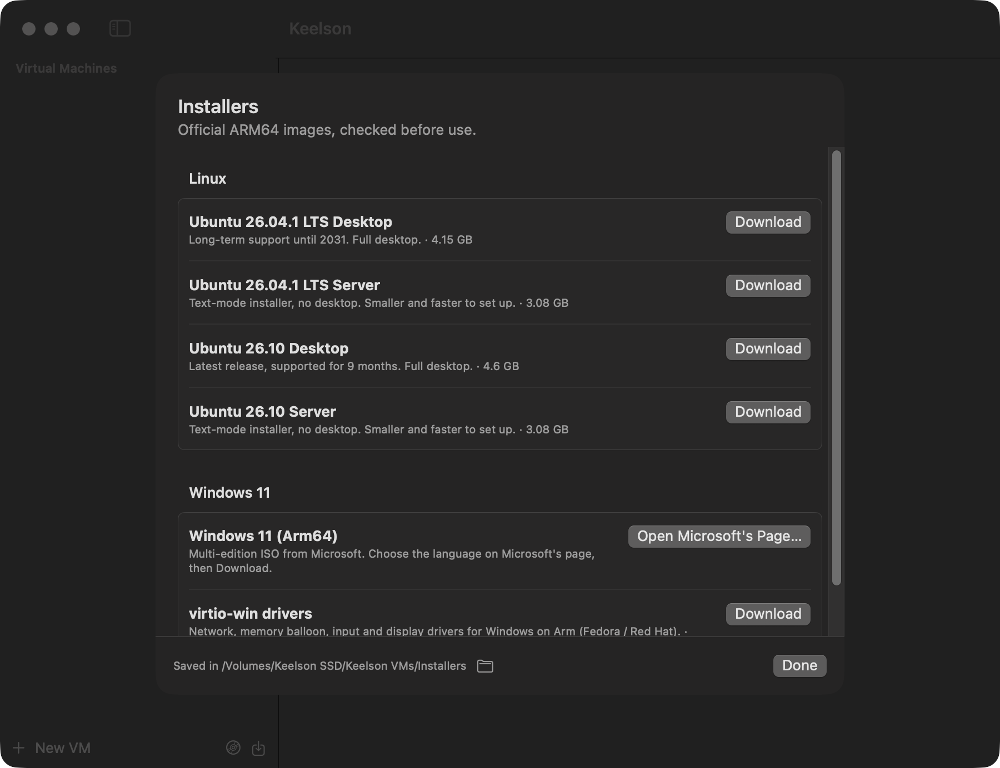

<p align="center"></p>

<h1 align="center">Keelson</h1>

<p align="center">Linux and Windows 11 virtual machines for Apple silicon Macs, on any drive, including whole external SSDs.</p>

<p align="center">
  
  
  
  
</p>

<p align="center"><a href="../../releases/latest"><b>⬇ Download Keelson for Mac (.dmg)</b></a></p>

| Library | New VM |
| --- | --- |
|  |  |

## What it does

- **Linux (ARM64)** on Apple's built-in Virtualization framework, with nothing extra to install. It boots any
  ARM64 installer ISO and supports automatic display resizing, clipboard sharing, shared folders and
  **Rosetta** for x86-64 Linux programs.
- **Windows 11 (ARM64)** through QEMU on Apple's Hypervisor framework (near-native CPU speed), with
  the TPM 2.0 chip Windows 11 requires.
- **External SSDs.** Keep VM files on any drive, or give a VM an **entire SSD** so the guest OS installs
  directly onto it and boots from it.
- **Installer downloads built in.** Ubuntu (latest LTS and latest release, checksum-verified), Windows 11
  for Arm from Microsoft's own page, and the virtio-win drivers, straight from the new-VM wizard.
- **Automatic updates** from GitHub Releases, signed and verified before they're installed.
- Library window, new-VM wizard, per-VM settings, pause/resume, shutdown and force power off.

Built and tested on an M4 Mac mini. Keelson is an original app. Parallels Desktop was examined only
to understand how a VM app is put together on Apple silicon (see [How it was designed](#how-it-was-designed)).

## Install

**Requires** macOS 14 or later on an Apple silicon Mac (M1–M4).

1. Download **`Keelson-<version>.dmg`** from the [latest release](../../releases/latest).
2. Open it and drag **Keelson** into **Applications**.

   

3. Eject the *Keelson* disk image.
4. **First launch:** Keelson is signed locally rather than notarized by Apple, so macOS blocks a
   normal double-click the first time. Right-click Keelson in Applications and choose **Open**, then
   **Open** again. After that it opens normally. Alternatively, run:

   ```bash
   xattr -dr com.apple.quarantine /Applications/Keelson.app
   ```

5. **Windows guests only:** install QEMU and the TPM emulator with [Homebrew](https://brew.sh):

   ```bash
   brew install qemu swtpm
   ```

   Keelson finds them automatically. You can set a custom QEMU path in **Keelson ▸ Settings**.

`Keelson-<version>.zip` on the release page contains the same app if you'd rather not use the disk image.

### Updates

Keelson checks GitHub for a new release once a day and offers to install it: you see the release notes,
click **Install and Relaunch**, and it's done. Use **Keelson ▸ Check for Updates…** to check now, or turn
automatic checks off in **Keelson ▸ Settings**. Each update zip is signed with an Ed25519 key, and Keelson
won't install one whose signature doesn't match the key built into the app. Keelson must be in a folder you
can write to (like Applications) to update itself; shut down running VMs first.

*Coming from 1.0.0?* That version has no updater, so install 1.1.0 from the DMG once. Updates are automatic after that.

To check that virtualization works on your Mac, run the built-in self-test. It boots a throwaway VM
and deletes it afterwards:

```bash
/Applications/Keelson.app/Contents/MacOS/Keelson --selftest
```

## Create your first VM

1. Click **New VM** (or press ⌘N).
2. Pick **Linux** or **Windows 11**. Keelson chooses the right engine and suggests CPU, memory and disk sizes.
3. Next to **Installer ISO**, click **Download…** to get Ubuntu or Windows 11 (see below), or **Choose…** to
   use an ISO you already have. You can create the VM while the download runs; it starts once it's done.
4. Under **Storage**, pick where the VM lives (see below), then click **Create**.
5. Select the VM and click **Start**, then install the OS as you would on a real PC.

## Downloading installers

Open **File ▸ Download Installers…** (⇧⌘D), the disc button at the bottom of the sidebar, or **Download…**
next to an ISO field.



| Installer | Where it comes from | How it's checked |
| --- | --- | --- |
| Ubuntu Desktop / Server (arm64), newest LTS and newest release | cdimage.ubuntu.com, looked up live | SHA-256 from the release's `SHA256SUMS` file. A mismatch deletes the file. |
| Windows 11 (Arm64) | Microsoft's [download page](https://www.microsoft.com/software-download/windows11arm64), shown inside Keelson | SHA-256 compared with the list Microsoft shows on the same page. |
| virtio-win drivers | fedorapeople.org (Fedora / Red Hat), newest stable | HTTPS (no checksum is published). |

Files are saved in `Installers` inside your Keelson VMs folder (change it in Settings to keep them on an SSD).
Downloads continue in the background and can be stopped and resumed.

**Why does Windows open Microsoft's page?** Microsoft only creates ISO download links for a person using its
page, so Keelson shows that page rather than fetching links behind your back. Choose
*Windows 11 (multi-edition ISO for Arm64)* ▸ **Download Now**, pick your language ▸ **Confirm**, then click
**Download**. Keelson saves the ISO and fills it into the wizard.

## Using external SSDs

**Option 1: VM file on the SSD (recommended).** In *New VM ▸ Storage ▸ Virtual disk file*, click
the SSD's name under *External drives* (or *Choose…*). The VM folder (`Name.keelsonvm`) lives on the
SSD. Format the SSD as **APFS** so disk files stay sparse, meaning they only use the space the guest has
actually written. If the SSD is unplugged, the VM shows under *Offline* and comes back when you
reconnect it.

**Option 2: Entire SSD.** Choose *Entire external SSD*, pick the disk, and type `ERASE`. The guest
installer partitions the SSD and the OS boots from it. When you start the VM:

1. Keelson finds the SSD by model and size, because its `diskN` number can change between plug-ins.
2. It unmounts the SSD's volumes and stops macOS from re-mounting them while the VM runs.
3. macOS asks for your administrator password (`authopen`) to grant raw access to that one disk.
   Keelson itself never runs as root.

The boot disk and any drive that holds Keelson VM files are never offered for Option 2.

## Installing Linux

Use an **ARM64 / aarch64** ISO: download Ubuntu from inside Keelson, or bring your own (Fedora Workstation
aarch64, Debian arm64…). Create the VM, pick the ISO, Start, and install as normal. Afterwards, remove the
ISO in *Settings*.

- Clipboard sharing: install `spice-vdagent` in the guest.
- Shared folders: add them in *Settings*, then `sudo mount -t virtiofs keelson /mnt/keelson`.
- Rosetta (run x86-64 Linux programs): `sudo mount -t virtiofs rosetta /media/rosetta`, then register it
  with `binfmt_misc` as described in Apple's *Running Intel binaries in Linux VMs with Rosetta*.

## Installing Windows 11

Needs `brew install qemu swtpm` (see [Install](#install)).

1. New VM ▸ **Windows 11**. Next to *Installer ISO* click **Download…** ▸ *Open Microsoft's Page…* and
   download the Arm64 ISO (or choose one you have). Next to *Drivers ISO* click **Download…** and get
   *virtio-win*. Give the VM at least 4 CPU cores, 8 GB memory and a 64 GB disk.
2. Leave **Setup helpers** on, then Create and **Start**. A QEMU window opens and Windows Setup starts by itself.
3. Install as normal. Networking works during setup, and *I don't have internet* is offered if you want a
   local account.
4. When Windows is installed, remove the installer ISO in *Settings* so the VM boots straight from its disk.

**What the setup helpers do.** While the installer is attached, Keelson adds a small disk with an
`autounattend.xml` answer file (the VM's `keelson-setup.iso`). It only fills in what a VM needs; every
normal setup page still appears:

- presses the key at *Press any key to boot from CD or DVD* (only on a blank disk), so the VM doesn't drop
  into the UEFI shell;
- skips Windows 11's TPM / Secure Boot / CPU / RAM checks, which matters if `swtpm` isn't installed;
- installs every Windows 11 ARM64 driver from the virtio-win ISO (network, balloon, input, display, serial)
  during setup. A log is written to `C:\Windows\Temp\keelson-setup.log`;
- allows finishing setup offline with a local account.

Turn them off in the VM's *Settings ▸ Installer media* to run Windows Setup completely unmodified.

**Troubleshooting**

- *QEMU failed to start … HV_BAD_ARGUMENT*: fixed in 1.1.0 (the TPM is attached with `ppi=off`). Update Keelson.
- *UEFI Interactive Shell*: the installer didn't boot. Check the ISO is the **Arm64** one, type `exit`, and
  pick the USB CD under *Boot Manager*.
- The QEMU log for each VM is `keelson.log` inside its `.keelsonvm` folder (select the VM and click **Show in Finder**).

Windows uses a basic framebuffer display. It's fine for desktop use but has no 3D acceleration.

## Known limits

| Feature | Status |
| --- | --- |
| Bridged networking, USB device passthrough | Not available. Both need entitlements Apple grants only to approved vendors. VMs use NAT networking. |
| Windows 3D graphics, shared folders, clipboard | Not available (no Windows guest tools yet). |
| Notarization | Not notarized, so the first launch needs right-click ▸ Open (see [Install](#install)). |
| Snapshots, disk resizing | Not implemented yet. |
| x86-64 Windows/Linux guests | Not supported. ARM64 guests only; x86 *apps* run inside them through Windows' built-in emulation or Rosetta for Linux. |
| macOS guests | Not implemented (the Apple engine supports them; it's a natural next feature). |

## Building from source

Requires Xcode (Swift 5.10+) and macOS 14 or later.

```bash
./scripts/build-app.sh
```

This builds `build/Keelson.app` and signs it locally. To sign with a Developer ID instead, set
`SIGN_IDENTITY="Developer ID Application: …"`.

To package the drag-to-install disk image `build/Keelson-<version>.dmg`:

```bash
./scripts/build-dmg.sh
```

Add `--build` to build the app first. The styled installer window needs
[`create-dmg`](https://github.com/create-dmg/create-dmg) (`brew install create-dmg`); without it the
script makes a plain disk image with `hdiutil`. The window background is drawn by
`scripts/dmg-background.swift`.

### Releasing

Releases are built, signed and published by GitHub Actions; installed copies update themselves from them.

1. While working, add notes under `## Unreleased` in `CHANGELOG.md`.
2. Run **Actions ▸ Bump version ▸ Run workflow** and pick `patch`, `minor`, `major` or an exact version. It
   moves the notes under the new version, bumps `Resources/Info.plist`, commits and tags `v<version>` on
   `main`, then builds the DMG and the signed update zip and publishes the GitHub release.

Pushing a `v*` tag yourself runs the same release job (`.github/workflows/release.yml`). To release from a
Mac instead: `scripts/bump-version.sh minor`, commit, then `scripts/release.sh --publish` (it runs
`--selftest` first, which CI can't because GitHub's runners don't allow nested virtualization).

**Update signing key.** `swift scripts/update_keys.swift generate` creates the Ed25519 key in
`~/.config/keelson/update_signing_key` (never commit it) and prints the public key, which lives in
`Resources/Info.plist` as `KSUpdatePublicKey`. CI reads the same key from the repository secret
`KEELSON_UPDATE_PRIVATE_KEY`. If the key is lost, ship a new public key in a release users install by hand.

The **Build** workflow builds every push and pull request.

To check a published release end to end without replacing the app (download, signature, unpack):

```bash
build/Keelson.app/Contents/MacOS/Keelson --check-update
```

## How it was designed

Parallels Desktop 1.26.4 (App Store edition) was inspected with REA, looking only at bundle
layout, linked system frameworks, entitlements and imported API names. No code was decompiled or copied.

| Observation (Parallels) | Keelson's approach |
| --- | --- |
| `Parallels VM.app` (Windows/Linux) links **Hypervisor.framework** + **vmnet** and has its own device emulation. Entitlements: `hypervisor`, `vm.networking`, `vm.device-access`. | Windows: QEMU, the open-source equivalent of a Hypervisor.framework VMM with full device emulation. Linux: Apple's Virtualization framework. The two `vm.*` entitlements are Apple-restricted, so no bridged networking or USB passthrough. |
| `Parallels Mac VM.app` uses **Virtualization.framework** (`VZVirtualMachine`, `VZEFI…`, virtio devices, `VZNetworkBlockDeviceStorageDeviceAttachment`). | Linux guests use the same framework: EFI boot, virtio block/net/GPU/sound, virtiofs shares, SPICE clipboard, Rosetta. |
| Imports **DiskArbitration** (`DADiskUnmount`, `DARegisterDiskEjectApprovalCallback`, approval sessions) to manage physical disks. | Whole-SSD mode unmounts via `diskutil`, refuses mounts with a DiskArbitration approval callback while the VM runs, and gets raw access through `authopen`. |
| Separate processes per VM (`prl_vm_app`, `prl_macvm_app`) under a control service. | QEMU VMs run as separate child processes controlled over QMP. Apple-engine VMs run in Keelson's own process, which is how Virtualization.framework is designed to be used. |

## Project layout

```
Sources/Keelson/
  KeelsonApp.swift          app entry, windows, menus, quit handling
  SelfTest.swift            --selftest, --catalog, --fetch
  Model/                    VMConfig + bundle format, VMInstance (lifecycle), VMLibrary
  Engine/                   AppleRunner (Virtualization.framework), QEMURunner + QMP, Spawner,
                            WindowsSetupMedia (answer-file disk)
  Installers/               InstallerCatalog (Ubuntu/Windows/virtio-win), DownloadManager
  Update/                   Updater (GitHub Releases, Ed25519 verification, update window)
  Disk/                     DiskScanner (diskutil), RawDiskAccess (authopen), MountBlocker
  UI/                       library, VM detail, new-VM wizard, settings, installers, Microsoft page, VM display
Resources/                  Info.plist, entitlements, app icon
scripts/
  build-app.sh              build and sign Keelson.app
  build-dmg.sh              package the drag-to-install DMG
  release.sh                build, sign and (with --publish) publish a release
  bump-version.sh           set the next version and date the changelog
  update_keys.swift         create the update signing key, sign files
  dmg-background.swift      draws the DMG window background
.github/workflows/          build (CI), release, bump version
docs/                       README images
```

## License

[MIT](LICENSE) © 2026 Pranav Dwivedi
