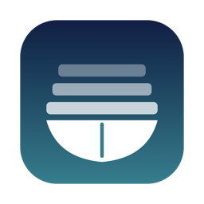
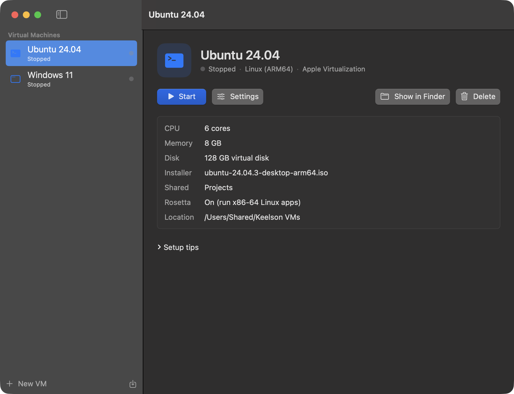
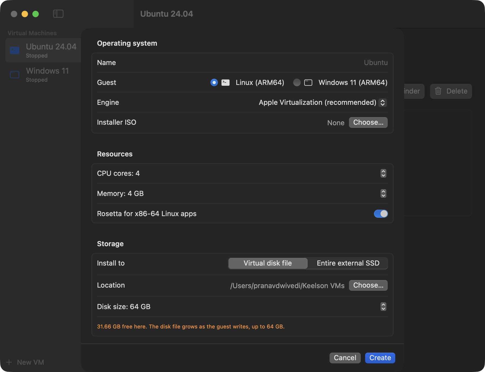

<p align="center"></p>

<h1 align="center">Keelson</h1>

<p align="center">Linux and Windows 11 virtual machines for Apple silicon Macs, on any drive, including whole external SSDs.</p>

<p align="center">
  
  
  
  
</p>

Built and tested on an M4 Mac mini. Keelson runs **Linux** and **Windows 11 for ARM**, and you can
put VMs on your **external SSDs**: either as a VM file on the drive, or by giving a VM an entire SSD
so the OS installs directly onto it.

Keelson is an original app. It isn't derived from Parallels code. Parallels Desktop was examined
only to understand how a VM app is put together on Apple silicon (see *How it was designed*).

| Library | New VM |
| --- | --- |
|  |  |

## Download

Get `Keelson.zip` from the latest [release](../../releases/latest), unzip, and move `Keelson.app` to
`/Applications`. The app is signed locally rather than notarized, so the first time, right-click it
and choose **Open**, or run:

```bash
xattr -dr com.apple.quarantine /Applications/Keelson.app
```

## Build

```bash
./scripts/build-app.sh
```

This produces `build/Keelson.app`, signed locally. Copy it to `/Applications` if you like.
Requires Xcode (Swift 5.10+) and macOS 14 or later.

Check that virtualization works on your Mac:

```bash
build/Keelson.app/Contents/MacOS/Keelson --selftest
```

## Windows needs QEMU

Linux runs on Apple's built-in Virtualization framework with nothing to install. Windows 11 needs
a TPM 2.0 chip, NVMe storage and a basic UEFI display, which Apple's framework doesn't provide, so
Keelson runs Windows through QEMU on Apple's Hypervisor framework (near-native CPU speed).

```bash
brew install qemu swtpm
```

`swtpm` provides the TPM. Keelson finds both automatically. You can set a custom path in Keelson ▸ Settings.

## Using external SSDs

**Option 1 – VM file on the SSD (recommended).** In *New VM ▸ Storage ▸ Virtual disk file*, click
the SSD's name under *External drives* (or *Choose…*). The VM folder (`Name.keelsonvm`) lives on the
SSD. Format the SSD as **APFS** so disk files stay sparse (they only use the space the guest has
actually written). If the SSD is unplugged, the VM shows under *Offline* and comes back when you
reconnect it.

**Option 2 – Entire SSD.** Choose *Entire external SSD*, pick the disk, type `ERASE`. The guest
installer partitions the SSD and the OS boots from it. When you start the VM:

1. Keelson finds the SSD by model and size (its `diskN` number can change between plug-ins).
2. It unmounts the SSD's volumes and stops macOS from re-mounting them while the VM runs.
3. macOS asks for your administrator password (`authopen`) to grant raw access to that one disk.
   Keelson itself never runs as root.

The boot disk and any drive that holds Keelson VM files are never offered for Option 2.

## Installing Linux

Use an **ARM64 / aarch64** ISO (Ubuntu Desktop arm64, Fedora Workstation aarch64, Debian arm64…).
Create the VM, pick the ISO, Start, and install as normal. Afterwards, remove the ISO in *Settings*.

- Clipboard sharing: install `spice-vdagent` in the guest.
- Shared folders: add them in *Settings*, then `sudo mount -t virtiofs keelson /mnt/keelson`.
- Rosetta (run x86-64 Linux programs): `sudo mount -t virtiofs rosetta /media/rosetta`, then register it
  with `binfmt_misc` as described in Apple's *Running Intel binaries in Linux VMs with Rosetta*.

## Installing Windows 11

1. Get the **Windows 11 Arm64** ISO from Microsoft's download page.
2. New VM ▸ Windows 11 ▸ engine *QEMU + Hypervisor* ▸ pick the ISO. Give it at least 4 CPU cores, 8 GB memory, 64 GB disk.
3. Start. A QEMU window opens. When it says *Press any key to boot from CD or DVD*, click in the window and press a key.
4. Networking during setup: Windows has no built-in driver for the virtual network card. Either
   - attach the [virtio-win](https://github.com/virtio-win/virtio-win-pkg-scripts) ISO as the *Drivers ISO* and load the `NetKVM\w11\ARM64` driver, or
   - at the network screen press **Shift+F10** and run `OOBE\BYPASSNRO`, finish setup offline, then install the drivers from the ISO.
5. If Setup says *This PC can't run Windows 11*, `swtpm` isn't installed. Install it, or press Shift+F10 and run:
   ```
   reg add HKLM\SYSTEM\Setup\LabConfig /v BypassTPMCheck /t REG_DWORD /d 1
   reg add HKLM\SYSTEM\Setup\LabConfig /v BypassSecureBootCheck /t REG_DWORD /d 1
   ```

Windows's display is a basic framebuffer: good for desktop use, no 3D acceleration.

## Known limits

| Feature | Status |
| --- | --- |
| Bridged networking, USB device passthrough | Not available. Both need entitlements Apple grants only to approved vendors. VMs use NAT networking. |
| Windows 3D graphics, shared folders, clipboard | Not available (no Windows guest tools yet). |
| Snapshots, disk resizing | Not implemented yet. |
| x86-64 Windows/Linux guests | Not supported. ARM64 guests only; x86 *apps* run inside them through Windows' built-in emulation or Rosetta for Linux. |
| macOS guests | Not implemented (the Apple engine supports them; it's a natural next feature). |

## How it was designed

Parallels Desktop 1.26.4 (App Store edition) was inspected with REA, looking only at bundle
layout, linked system frameworks, entitlements and imported API names. No code was decompiled or copied.

| Observation (Parallels) | Keelson's approach |
| --- | --- |
| `Parallels VM.app` (Windows/Linux) links **Hypervisor.framework** + **vmnet** and has its own device emulation. Entitlements: `hypervisor`, `vm.networking`, `vm.device-access`. | Windows: QEMU, the open-source equivalent of a Hypervisor.framework VMM with full device emulation. Linux: Apple's Virtualization framework. The two `vm.*` entitlements are Apple-restricted, so no bridged networking or USB passthrough. |
| `Parallels Mac VM.app` uses **Virtualization.framework** (`VZVirtualMachine`, `VZEFI…`, virtio devices, `VZNetworkBlockDeviceStorageDeviceAttachment`). | Linux guests use the same framework: EFI boot, virtio block/net/GPU/sound, virtiofs shares, SPICE clipboard, Rosetta. |
| Imports **DiskArbitration** (`DADiskUnmount`, `DARegisterDiskEjectApprovalCallback`, approval sessions) to manage physical disks. | Whole-SSD mode unmounts via `diskutil`, refuses mounts with a DiskArbitration approval callback while the VM runs, and gets raw access through `authopen`. |
| Separate processes per VM (`prl_vm_app`, `prl_macvm_app`) under a control service. | QEMU VMs run as separate child processes controlled over QMP. Apple-engine VMs run in Keelson's own process, which is how Virtualization.framework is designed to be used. |

## Project layout

```
Sources/Keelson/
  KeelsonApp.swift          app entry, windows, quit handling
  SelfTest.swift            --selftest
  Model/                    VMConfig + bundle format, VMInstance (lifecycle), VMLibrary
  Engine/                   AppleRunner (Virtualization.framework), QEMURunner + QMP, Spawner
  Disk/                     DiskScanner (diskutil), RawDiskAccess (authopen), MountBlocker
  UI/                       library, VM detail, new-VM wizard, settings, VM display window
```
